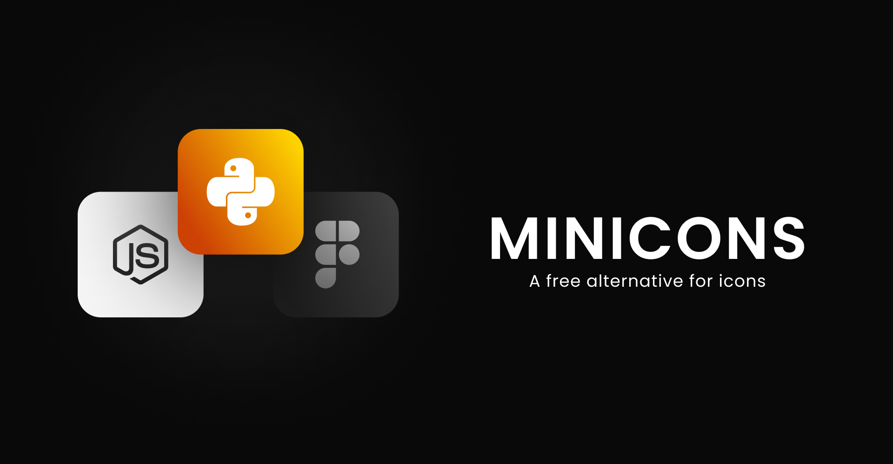
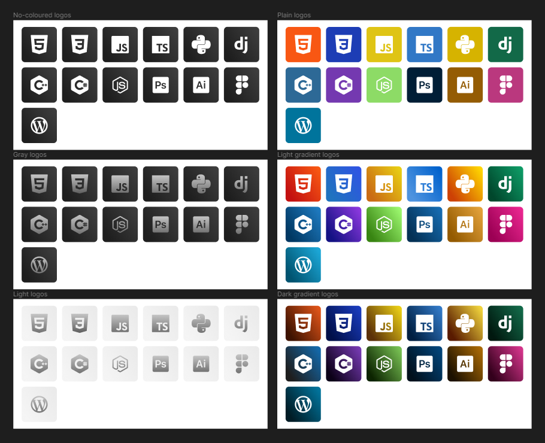

# Minicons



**Minicons** is a curated collection of SVG icons and logos designed for use in websites, applications, portfolios, documentation, and other digital projects.

The project focuses on software, platforms, programming languages, frameworks, libraries, and other technologies, bringing their recognizable visual identities into a consistent and standardized icon system.

Each icon is carefully prepared to remain clean, scalable, and visually coherent across the collection.

## Preview



## Styles

Minicons currently provides six visual variations:

- **Plain** — original or primary visual style.
- **Light Background** — optimized for light surfaces.
- **Dark Background** — optimized for dark surfaces.
- **Gradient** — gradient-based variation.
- **Light Gray** — monochromatic light-gray variation.
- **Dark Gray** — monochromatic dark-gray variation.

The repository is organized using the following directories:

```text
minicons/
├── plain/
├── light-background/
├── dark-background/
├── gradient/
├── light-gray/
└── dark-gray/
```

## How to use

Choose the style you want, open the corresponding directory, and select the SVG file you need.

### Use the raw SVG URL

Each SVG can be referenced through its raw GitHub URL and embedded directly in websites, documentation, or other supported environments.

```html

```

Raw URLs remain valid as long as the file path and branch are not changed.

### Download the SVG

You can also download any icon directly from GitHub:

1. Open the desired SVG file.
2. Click **Download raw file**.
3. Save the SVG and use it in your project according to the repository license.

## Features

- **Consistent visual identity** — icons follow the same design system across the collection.
- **Multiple styles** — six variants designed for different interfaces and backgrounds.
- **SVG format** — scalable vector assets that remain sharp at any resolution.
- **Technology-focused collection** — software, platforms, languages, frameworks, libraries, and related tools.
- **Curated assets** — each icon is prepared and reviewed individually rather than automatically generated.

## License

Minicons assets are available for use in **personal projects** under the terms described in [license.md](license.md).

The current license does **not permit modification** of the distributed icons.

Please review the license before using the assets in your project.

## Trademark notice

Product names, logos, brands, and trademarks represented in this repository belong to their respective owners.

Minicons is an independent project and is not affiliated with, sponsored by, or endorsed by the companies or organizations represented by these icons.

The designs in this repository are intended to provide a consistent visual representation of technologies while respecting the identity of their respective brands.

## Feedback and support

Suggestions, corrections, requests, and feedback are welcome.

If you find an issue with an icon or would like to suggest a technology for the collection, feel free to [open an issue](https://github.com/pauloarchanjo/minicons/issues).

Minicons is an ongoing project, and the collection will continue to evolve with new icons, improvements, and visual refinements.
